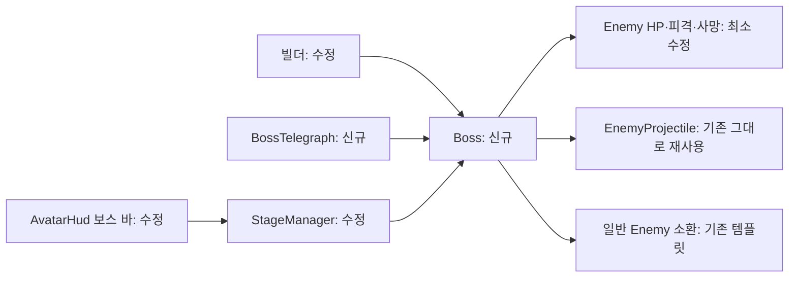

# Phase 4 — 보스 기능

## 적용 결과

최종 보스룸의 임시 MidBoss를 `BossRoom/Boss_Crusher`로 교체했다. 위치는 (0, 0, 144), 스케일 2.2, HP 8,400이며 약점 시스템은 없다. `Enemy`의 HP·피격·사망을 재사용하고 `Boss`가 패턴·페이즈·소환몹의 수명을 소유한다. 별도 설정 SO는 추가하지 않았다.

구조는 코디네이터에게 전달하여 승인을 받았다. `Enemy.healthOnly`는 기본 false이며 최종 보스에서만 true다. 일반 적과 중간보스의 기존 즉사·경직·넉백 규칙은 유지한다. 무기 moveset 및 ShearsFx/ChainsawFx/HammerFx 소스는 수정하지 않았다.

## 패턴과 페이즈

모든 공격은 방향/위치를 징조 시작 시 고정한다. 징조 중 추적 조준하지 않는다. 기본 표시는 주황색 외곽선과 몸체 색이며, 후속 연출 워커가 교체할 수 있다.

| 패턴 | 페이즈 1 기준 | 강화 및 회피 |
|---|---|---|
| 내려찍기 | 1초 징조, 전방 2.5m 지점 중심 반경 4m, 피해 24 | 한 번의 원형 판정. 범위 이탈·점프·대시 무적으로 회피 가능 |
| 돌진 | 1.2초 직선 사각 경고, 최대 12m, 속도 18m/s, 피해 22 | 이동한 구간 전체로 판정하여 프레임 사이 관통 방지. 공격당 피격 1회, 벽/도착/제한시간에 종료 |
| 탄막 | 0.9초 부채꼴 징조, 좌우 48도, 5발 1묶음, 피해 10 | 2페이즈 7발×2묶음, 3페이즈 9발×3묶음. 묶음 간격 0.42초/템포. 기존 EnemyProjectile 재사용 |
| 소환 | 1.3초, 소환 위치에 원형 징조 | 1페이즈 2마리, 이후 3마리 시도. 생존 최대 4마리, 플레이어와 3m 이상 거리 및 캡슐 비충돌 검사. 발동 시 위치가 막혔으면 생략 |

- 1페이즈 순서: 내려찍기 → 돌진 → 탄막 → 소환.
- 2페이즈 순서: 돌진 → 내려찍기 → 탄막 → 내려찍기 → 소환.
- 3페이즈 순서: 돌진 → 내려찍기 → 탄막 → 돌진 → 내려찍기 → 소환 → 탄막.
- HP 67% / 34%에서 다음 페이즈로 전환한다. 진행 중 공격을 취소하고 1.6초간 무적·포효 상태가 된다. 전환 중에도 보스는 정지한다.
- 템포는 1 / 1.15 / 1.30. 징조와 탄막 간격을 줄이고 돌진 속도를 올린다. 가장 짧은 내려찍기 징조도 약 0.77초다.
- 모든 패턴 뒤 빈틈은 2.5 / 2.15 / 1.8초. 마지막 0.5초에만 거리가 6m보다 멀면 접근한다. 최소 2 / 1.65 / 1.3초는 정지한 딜 타임이다.
- 모든 직접 공격은 `WeaponAvatar.TakeDamage`를 거치므로 기존 대시/피격 무적을 존중한다. 탄막도 기존 투사체의 같은 경로를 따른다.
- 플레이어가 사망하면 진행 중 공격을 취소한다. 전환 무적 타이머는 계속 진행하여 부활 후 무적이 고착되지 않는다. 기존 체크포인트/남은 보스 HP 보존 동작을 따른다.

## HP와 즉사 방지

`Boss.MaxHealth = 8400`을 빌더가 Enemy.maxHp에 기록한다. 근거는 정지 표적에 대한 스킬/궁극기 없는 지속 피해의 대략적인 평균 48 DPS, 회피·거리 확보·빈틈 활용을 포함한 공격 가능 비율 74%, 페이즈 전환 2회 3.2초다. `48 × 0.74 × (240 - 3.2) ≈ 8411`이므로 8,400으로 반올림했다.

현재 데이터의 기준값은 가위 14/16/27 피해와 기본 콤보 합계 1.33초(약 43 DPS), 전기톱 기본 12·0.1초 틱(접촉 최대 120 DPS, 공중/스윙 비접촉 시간을 포함한 지속 추정 약 60), 망치 약 32~34 DPS, 소총 7/0.09초·40발·재장전 1.6초(약 54 DPS)다. 평균 약 47~48 DPS다. 체인 조기 연결, 히트스톱, 실제 접촉률, 스킬/궁극기, 동시 작업 중인 무기 변경은 이 수치를 바꾸므로 **4분은 초기 추정이며 실측 결과가 아니다**.

- healthOnly는 slice/sliceNow/sliceDelay/sliceRadius/crush를 해제하여 순수 damage만 적용한다. HP가 남으면 절단·압착으로 사망하지 않는다. HP가 0일 때 기존 일반 사망 처리로 들어간다.
- 경직·넉백·피격 상승·네일 핀을 막아 패턴이 무한 경직으로 봉쇄되지 않게 한다. 피격 플래시와 가벼운 몸체 반응은 재사용한다.
- 접촉 네일의 최대 HP 비례 피해와 관통 네일 즉사도 보스에서 각각 고정 12/30 피해로 변환한다. 현재 선택 무기에는 없지만 Enemy의 공개 우회 사망 경로까지 보호했다.
- 전환 중 Invulnerable은 피해와 피격 이벤트를 함께 차단한다.

## HUD·클리어·양쪽 경로

`AvatarHud`는 최종 전투 중 상단 중앙에 이름 파쇄자, PHASE n/3, 수치와 HP 바를 표시한다. 포효 중에는 청색과 무적 문구를 쓴다. 기존 클리어 문구에서 임시 보스 표현만 제거했다.

`StageManager`는 최종 보스 Enemy.IsDead를 확인하면 소환몹을 정리하고 기존 ArenaCleared/RunCompleted 및 문 개방 흐름을 실행한다. 소환몹을 추가로 잡아야 클리어되는 구조가 아니다.

작업 중 추가된 사용자 결정도 반영했다. 반대편 갈래 차단 조건과 RouteA_Gate/RouteB_Gate 배치를 제거했다. 양쪽 중간보스를 모두 처치하면 소총과 망치를 모두 획득할 수 있으며, 어느 한쪽만 처치해도 최종 보스 진입이 허용된다. SelectedRoute는 마지막 진입 경로이며 소유권/최종 보스 입장 조건으로 쓰지 않는다. StageFx의 상대 홀로그램 파괴·소멸·봉쇄 문구도 제거했다. StageGuideFx는 원래 양쪽 경로를 계속 표시하므로 수정하지 않았다.

## 후속 연출 훅

`Boss`의 `event Action<Boss>`:

- `TelegraphStarted`, `TelegraphEnded`, `AttackFired`, `AttackCancelled`, `AttackEnded`.
- `VolleyFired`: 탄막의 각 묶음 생성 직후.
- `PhaseTransitionStarted`, `PhaseTransitionEnded`, `Roared`, `Defeated`.

공개 상태: `State`, `Pattern`, `Phase`, `Health`, `HealthRatio`, `IsInvulnerable`, `IsTelegraphing`, `TelegraphProgress`, `PhaseProgress`, `AimDirection`, `AttackOrigin`, `ImpactPoint`, `ChargeEnd`, `SummonPoints`. 징조 종료 이벤트는 정상 발동과 취소 양쪽에서 발생하고 이후 구체 이벤트가 이어진다. 내려찍기 충격파는 AttackFired+Slam, 돌진 잔상은 State==Attacking+Charge, 포효/전환은 전용 이벤트를 쓰면 된다. 공격 종료는 AttackEnded, 중단은 AttackCancelled를 구독한다.

범위·속도·피해·징조시간·무적시간·빈틈·최대 소환수·템포와 페이즈 감소량은 공개 const다. `BossTelegraph`는 기본 경고만 그리므로 고급 연출을 붙이면 해당 컴포넌트를 비활성화할 수 있다. `EnemyProjectile`·`EnemyAttack` 소스는 수정하지 않았다.

기존 StageFx는 최종 보스 명찰을 TemporaryBossRoom의 MidBoss로 찾는다. 기본 입장 배너/효과는 arena center 폴백으로 유지되지만, 후속 보스 연출 워커는 `BossRoom/Boss_Crusher` 및 Boss API로 최종 명찰/인트로를 연결해야 한다. 이 연결 정보를 코디네이터에게 별도 전달했다.

## 검증

- 최종 recompile: completed, failed=false, errors=[], compilationFailed=false.
- 최종 eval: Play mode false를 확인한 뒤 `WeaponAvatarSceneBuilder.Build()` 호출, success=true, diagnostics=[].
- 저장 씬: Assets/Scenes/WeaponAvatarScene.unity, UTC 2026-10-31T08:26:30.6777038Z (KST 17:26:30).
- 씬 조회: Boss=1, Boss_Crusher at (0,0,144), maxHp=8400, healthOnly=true, respawn=false, EnemyAttack 없음, MidBoss 없음, BossTelegraph 있음, 소환 템플릿 EnemyMelee, arenaCenter=(0,0,144), StageManager 참조 일치.
- StageDoor=8. RouteA_Gate/RouteB_Gate 없음. 일반 적/중간보스 healthOnly=false 확인.
- 빌더가 통상 생성하는 씬·Avatar 무기 4종 에셋/머티리얼도 다시 저장했다. 대표 데이터 재조회: 전기톱 damage=12, tickInterval=0.1, 첫 콤보 bodyYaw=360, leap=1. 소스 무기 파일은 건드리지 않았다.
- 새 Boss.cs/BossTelegraph.cs의 Unity .meta 생성 확인.
- 플레이 모드 진입·스크린샷·Git 작업·관리자 작업은 하지 않았다. Orca 로컬 런타임 연결에는 샌드박스 승인 경로만 사용했다.

## 플레이로 확인할 점

실제 약 4분 클리어와 무기별 격차, 스킬/궁극기의 단축 폭, 세 페이즈의 징조 가독성과 대시 무적 타이밍, 내려찍기 점프 회피, 돌진의 벽/플레이어 충돌, 부채꼴 틈과 다중 탄막, 소환 제한/안전거리/처치 후 정리, 사망 후 재진입과 HP 유지, 양쪽 보상 획득 및 한쪽만 처치 후 보스 진입, 보스 사망 직후 클리어를 확인해야 한다. 고급 포효·충격파·잔상·전환 연출은 다음 워커 범위다.
